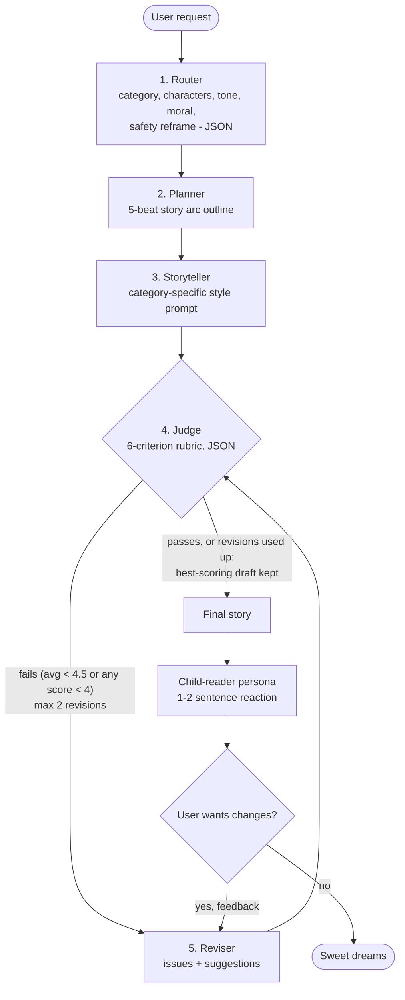

# Bedtime Story Agent: Design

## Run
```
pip install -r requirements.txt
copy .env.example .env        # then edit .env and paste your key
python main.py
```
The key is read from `.env` (git-ignored) or the `OPENAI_API_KEY` environment variable, and is never committed. Model stays `gpt-3.5-turbo`.

## Block diagram


## Design choices
- **Router first.** One cheap, deterministic (temp 0) call produces structured JSON that steers every later prompt and
  maps the request to a style guide (adventure, animal, friendship, fantasy, everyday). It also reframes unsafe requests
  into kid-friendly ones instead of refusing.
- **Plan before writing.** An explicit 5-beat arc (setup, hook, rising action, climax, wind-down) gives gpt-3.5 structure
  and makes every story end calmly for bedtime.
- **Judge loop (self-refine).** The judge scores age-appropriateness, arc, engagement, faithfulness, bedtime ending and
  length, and returns concrete issues and suggestions that go straight into the reviser prompt. The loop is capped at 2
  revisions, and the best-scoring draft wins, so a bad revision cannot make things worse.
- **Robust JSON.** `call_json` extracts the first JSON object and retries on parse failure; missing fields get defaults.
- **Temperatures.** 0 for router and judge (consistency), 0.7-0.8 for planning and writing (creativity).
- **User feedback.** After the story, the user can ask for changes; these go through the reviser and then the judge again.
- **Surprise.** A simulated 7-year-old reacts to each story, and judge scores are printed per draft so the improvement
  is visible.

## Limitations
The judge is the same small model as the writer, so scores are noisy and slightly generous. See the "next 2 hours" notes
at the top of `main.py`.
